# Bayesian Optimization for Adaptive Yield-Surface Discovery

> Research software, recorded benchmark results, figures, animations and the final presentation of a completed study. MIT-licensed original work; third-party attributions are in [NOTICE.md](NOTICE.md). Final presentation: [PPTX](presentations/Yield_Surface_Final_Showcase.pptx) · [PDF](presentations/Yield_Surface_Final_Showcase.pdf).

<p align="center">
  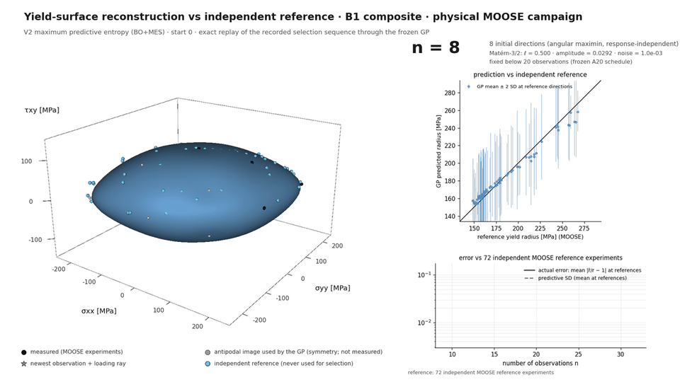
  <br><em>Each frame adds one recorded MOOSE experiment chosen by Bayesian acquisition. Blue: Matérn‑3/2 GP posterior-mean yield surface. Cyan: 72 independent MOOSE reference experiments that were never used for selection. Right: GP prediction vs reference (±2 SD), and the actual error vs the predictive SD.</em>
</p>

## Overview

Plasticity models of heterogeneous materials (composites, architected trusses) need the material's **effective yield surface**. Each point on it is the stress at which a representative volume element first yields under a given loading direction. That makes it expensive: every point needs one nonlinear finite-element simulation, here 130–300 s per composite RVE solve in MOOSE.

With a budget of only 33–64 experiments, **which loading directions to test** decides how accurate the reconstruction is. This repository contains a closed-loop Bayesian experimental-design system that works as follows:

1. It represents the surface as a radius function r(d̂) over unit loading directions, modelled by a **Matérn‑3/2 Gaussian process on log r**.
2. It chooses each next test from a finite library of **mechanically executable** loading directions using Bayesian acquisition.
3. It runs the test (MOOSE simulation or analytical oracle), measures the yield radius, updates the GP, and repeats.

Fixed designs, whether uniform or geometric, spend the same effort everywhere. An adaptive design can spend it where the surrogate is uncertain. The benchmarks below show **where that helps and where it does not**.

## Methodology

All quantities are in plane stress (σzz = 0, verified in the MOOSE models), in Mandel coordinates.

**1. Loading directions.** A unit Mandel vector

$$\hat{\mathbf d} = \frac{(\sigma_{xx},\,\sigma_{yy},\,\sqrt2\,\tau_{xy})}{\lVert(\sigma_{xx},\sigma_{yy},\sqrt2\,\tau_{xy})\rVert},\qquad \boldsymbol\sigma_y(\hat{\mathbf d}) = r(\hat{\mathbf d})\,\hat{\mathbf d}.$$

- **Candidate libraries:** 207 axes for the B1/B2 composites; a 4,096-axis Fibonacci half-sphere for the analytical studies; 8,192 signed directions for the TL1 truss.
- **Antipodal symmetry:** where r(d̂) = r(−d̂) was verified (composites, analytical families), candidates are unoriented axes and the GP receives antipodal pseudo-observations. It was **not** applied to TL1, which failed the admissibility test.

**2. Initial design: angular maximin.** Eight directions are chosen greedily, each maximizing its minimum (axial) angle to the current design. This step is response-independent and identical for every method at a given start.

**3. Matérn‑3/2 GP on y = log r**, with constant mean m₀ = median(y):

$$k(\mathbf x,\mathbf x') = a\Big(1+\tfrac{\sqrt3\,\rho}{\ell}\Big)e^{-\sqrt3\rho/\ell} + \sigma_w^2\,\delta,\qquad \rho = \lVert\mathbf x-\mathbf x'\rVert .$$

Hyperparameters follow schedule A20:
- **n < 20 observations:** fixed ℓ = 0.5, a = var(y), σ_w² = 1e‑3.
- **n ≥ 20:** ML‑II with 2 restarts, refitted at every step, within ℓ ∈ [0.05, 5], a ∈ [1e‑5, 10], σ_w² ∈ [1e‑6, 0.1].

**4. Posterior.** With K = k(X, X) + Λ (Λ holds the noise, jitter and pseudo-noise terms):

$$\mu_n(\mathbf x) = m_0 + k(\mathbf x,X)K^{-1}(\mathbf y-m_0),\qquad \sigma_n^2(\mathbf x) = a - a^2\, m(\mathbf x,X)K^{-1}m(X,\mathbf x)\ \ (\text{latent}).$$

The reconstruction is r̂(d̂) = exp μₙ(d̂). Its predictive uncertainty is σₙ on the log scale, i.e. relative.

**5–6. Acquisition and sequential selection.**
- **V2, maximum entropy sampling ("BO+MES"):** x_{n+1} = argmax over untested candidates of σₙ²(x). This is equivalent to maximizing the Gaussian predictive entropy ½ log(2πe σₙ²).
- **V3, LOO-error-weighted variance:** x_{n+1} = argmax σₙ²(x)·ρₙ(x). Here ρₙ interpolates standardized block leave-one-out residuals with a Matérn kernel of length 0.5 (see [docs/mathematical_method.md](docs/mathematical_method.md)).
- **Ties** are broken deterministically: the lowest index within a relative tolerance of 1e‑10.

**7. Update.** The measured radius is appended. A failed simulation marks its candidate unavailable. The GP is refitted, and the loop runs until the budget is spent.

**8. Evaluation.** The error is |r̂/r − 1| at **independent** reference directions that no controller ever sees:
- 72 (B1) and 71 (B2) MOOSE experiments;
- 482 for TL1;
- 20,000 exact points for the analytical surfaces.

Methods are compared with paired statistics (Wilcoxon signed-rank, Hodges–Lehmann ratio with exact CI, Holm correction).

## Results

Full tables: [`results/benchmark_summary.csv`](results/benchmark_summary.csv), [`docs/benchmarks.md`](docs/benchmarks.md). The ratio is the comparison method's error divided by this method's error; values above 1 favour the method.

| Evidence | Benchmark | Comparison (n) | Ratio [95 % CI] | Wins | p | Verdict |
|---|---|---|---|---|---|---|
| Analytical | **H1 holdout**: 24 Barlat Yld91 surfaces, pre-registered | V3 vs angular maximin (33) | **1.34** [1.13, 1.65] | 19/24 | 0.0012 (Holm) | confirmed |
| Analytical | H1 | V3 vs V2 BO+MES (33) | **1.48** [1.11, 1.69] | 23/24 | 4.5e‑6 (Holm) | confirmed |
| Analytical | H1 | V3 vs angular maximin (64) | **2.01** [1.69, 2.39] | 24/24 | 3.6e‑7 (Holm) | confirmed |
| Analytical | H1 ablation | V3 vs V3 driven by isotropic responses (33) | 1.01 [0.91, 1.12] | 12/24 | 0.79 | no difference |
| Physical (MOOSE) | B1 composite, 9 starts | V2 vs random (33) | 2.04 (mean error 0.29 % vs 0.58 %) | — | 0.0017 (Mann–Whitney) | V2 better |
| Physical (MOOSE) | B2 composite, 9 starts | V2 vs random (33) | 2.20 (0.23 % vs 0.49 %) | — | 0.0004 | V2 better |
| Physical (MOOSE) | B1 / B2 | V2 vs angular maximin (33) | 1.07 / 1.04 | 7/9, 6/9 | 0.055 / 0.25 | **not established** |
| Physical (MOOSE) | TL1 truss, 9 starts | V2 vs random (33) | 1.28 [1.07, 1.59] | 9/9 | 0.008 (Holm) | V2 better |
| Physical (MOOSE) | TL1 | V2 vs angular maximin (33) | 1.11 [1.01, 1.25] | 7/9 | 0.039 (Holm) | no supported difference (pre-specified win criterion not met) |
| Physical (MOOSE) | TL1 | frozen V3 vs angular maximin (33) | 1.11 [0.86, 1.21] | 7/9 | 0.41 (Holm) | no supported difference |

**What this shows**

- **Analytical surfaces.** On an independent, pre-registered holdout of anisotropic Yld91 surfaces, **V3 reconstructs the surface more accurately than a strong geometric baseline**: about 25 % lower paired error at n = 33 and about 50 % lower at n = 64. Absolute errors are already small (median 0.24 % vs 0.27 % at n = 33).
- **Physical MOOSE specimens.** **BO (V2) beats random sampling** on both composites and the truss. **Superiority over angular maximin was not established** on any physical specimen, and V3's analytical advantage did **not** transfer to TL1. V3 was not evaluated on B1/B2.
- **Why V3 wins.** The V3_ISO ablation matched V3, so the gain is a reproducible design bias, not demonstrated adaptation to the material's measured response.
- **Scaling (analytical A1–A6, up to 1,000 observations).** BO converges on every complexity level; for example, the A6 surface reaches 0.028 % mean error at n = 1,000. Here, too, an advantage over maximin was not shown at large budgets ([`results/analytical/A1_A6_complexity/`](results/analytical/A1_A6_complexity/)).

## Visual results

Every frame comes from recorded results. GP frames are exact replays of the recorded selection sequence through the frozen GP, with selections and score vectors verified bitwise against the records. Deformations come from recorded MOOSE states. Coordinates are x = σxx, y = σyy, z = τxy.

| | |
|---|---|
| 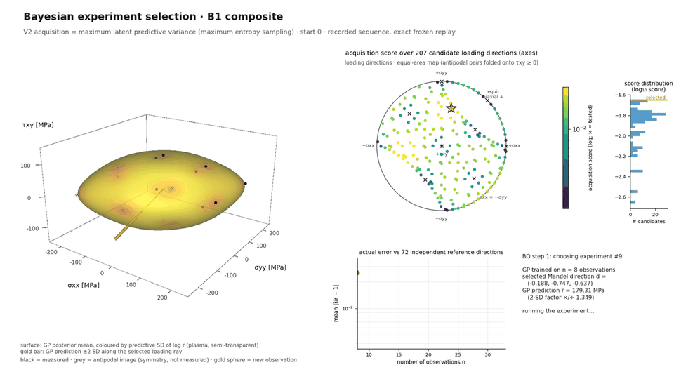<br>**Experiment selection (V2, B1 composite).** Acquisition score over all 207 candidate axes, the selected direction with the GP's prediction ±2 SD, then the recorded MOOSE result and the updated GP. | 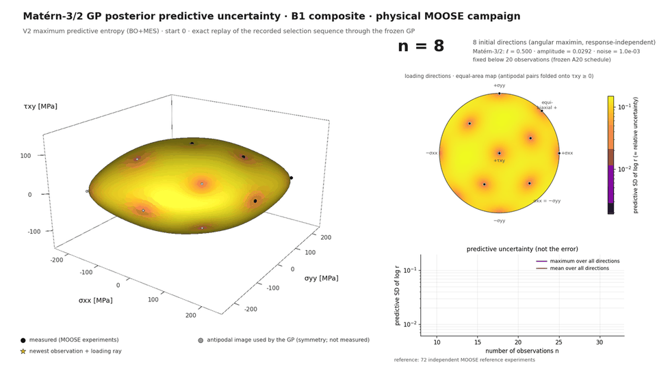<br>**Matérn GP predictive uncertainty** shrinking around each new observation. The drop at n = 20 is where ML‑II hyperparameter fitting begins. |
| 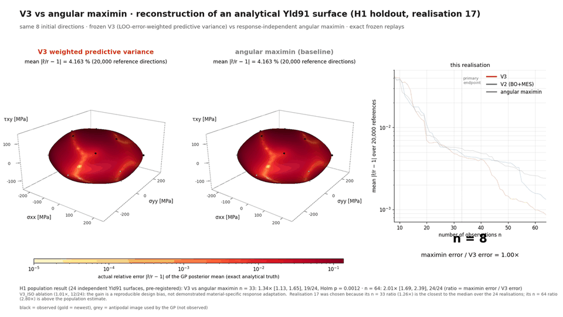<br>**V3 vs angular maximin** on an unseen Yld91 surface: error-coloured reconstructions and error curves at every n = 8…64. | 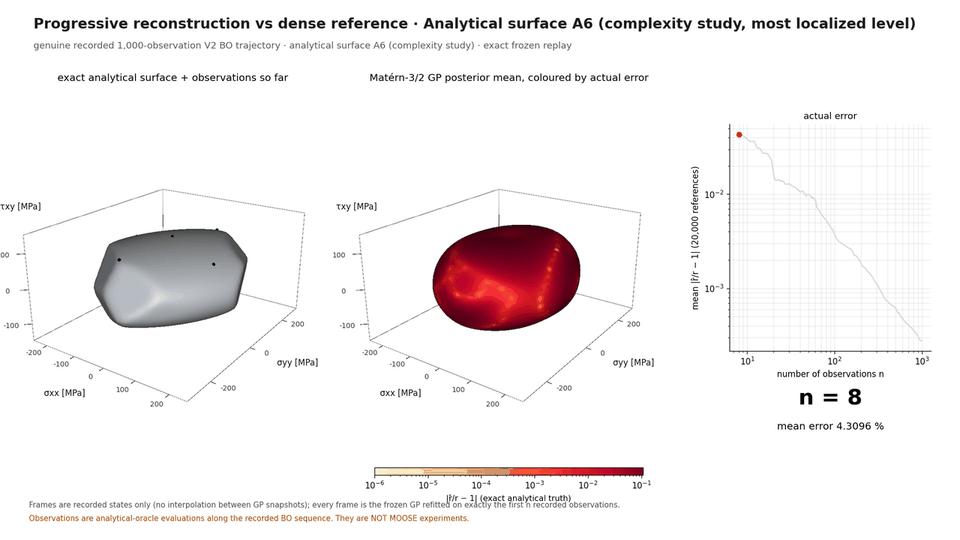<br>**1,000 sequential observations** on the most localized analytical surface (analytical oracle, not MOOSE): error falls from 4.3 % to 0.028 %. |
| 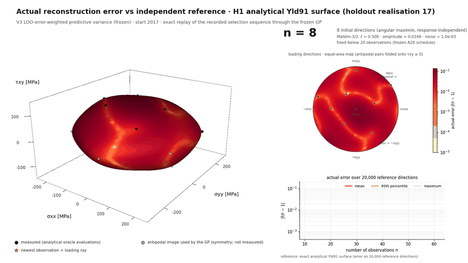<br>**Actual reconstruction error** against the exact surface (distinct from the predictive uncertainty). | 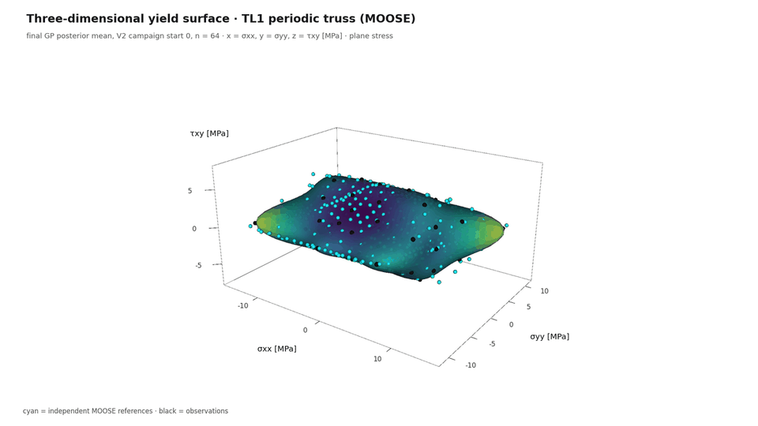<br>**TL1 truss yield surface** (final GP) with the 482 independent MOOSE references. |
| 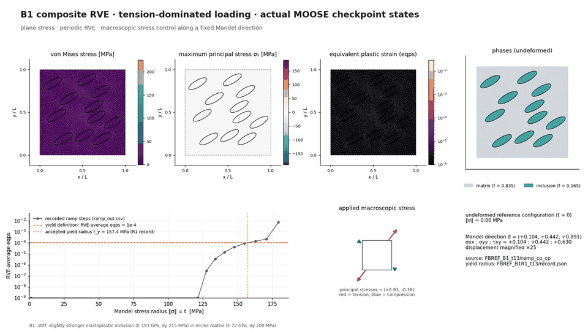<br>**B1 composite RVE, tension-dominated loading:** actual MOOSE displacement (×25), stresses and plastic strain through every recorded load step. | 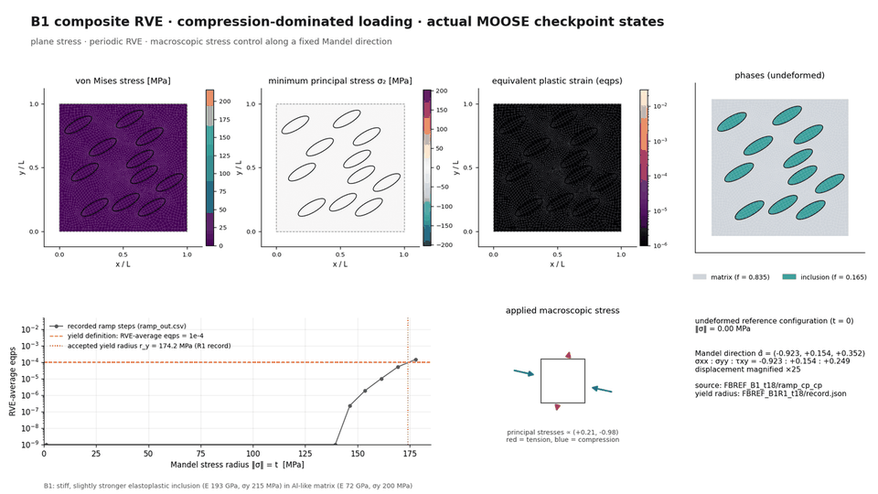<br>**B1 composite, compression-dominated loading,** with the same camera and scale. |
| 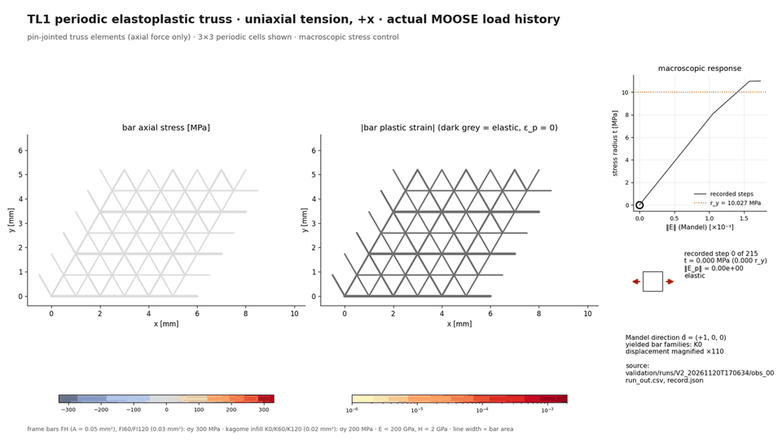<br>**TL1 truss, uniaxial tension (+x):** recorded bar stresses and yielding of the kagome infill. | 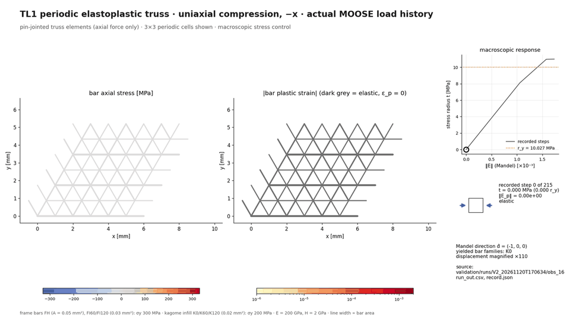<br>**TL1 truss, uniaxial compression (−x).** |

More: [`animations/`](animations/) (28 GIFs) and [`figures/`](figures/). Captions and sources are in [docs/visualization_guide.md](docs/visualization_guide.md).

## Quick start (no MOOSE needed)

```bash
git clone https://github.com/jarettpoliner/Bayesian_Optimization_Yield_Discovery.git
cd Bayesian_Optimization_Yield_Discovery
./setup.sh                    # ./.venv with pinned packages (Python >= 3.10; 3.12 for bitwise reproduction)
./verify_installation.sh      # frozen-source hashes + 16 tests (about 1 min)
./run_analytic_demo.sh        # V2, V3 and angular maximin on an analytical Yld91 surface
```

```bash
./ysbo methods
./ysbo run examples/analytic_v3_weighted.yaml     # writes outputs/analytic_v3_weighted/
```

```python
import os, sys; sys.path.insert(0, "software"); os.environ.setdefault("YSBO_ROOT", ".")
from yield_surface_bo import run_campaign, load_config
res = run_campaign(load_config("examples/analytic_v2_mes.yaml"))
print(res["radii"][:5])
```

## Reproduction

| Workflow | Needs MOOSE? | Command |
|---|---|---|
| Analytical BO (V2, V3, maximin, random) | no | `./ysbo run examples/analytic_*.yaml` |
| Replay of the recorded B1/B2/TL1 MOOSE campaigns through the frozen controllers | no | `./run_replay_demo.sh` |
| Full test suite | no | `./verify_installation.sh` |
| New TL1 truss campaign | **yes** (MOOSE installed separately) | `export YSBO_MOOSE_EXE=…/combined-opt; ./run_moose_demo.sh --live` |
| New composite campaigns | yes, plus the frozen research scripts | see [docs/reproduction.md](docs/reproduction.md) |

MOOSE is **not** included. The recorded results used commit `08315af82ed0b71e3edf82c04161b2da6a1aff19` with conda `moose-dev 2026.11.09` (`modules/combined/combined-opt`); see [docs/reproduction.md](docs/reproduction.md).

## Architecture

```
candidate library ─► controller (V2 / V3 / maximin) ─► frozen GPv2 (Matérn-3/2 on log r)
       ▲                    │  argmax acquisition            │ posterior mean / variance
       │                    ▼                                │
       └──── new observation ◄── oracle: MOOSE trial | analytical surface | recorded replay
evaluation (separate): independent references → |r̂/r − 1|, paired statistics
```

- `software/yield_surface_bo/` is the public API/CLI. It contains no selection mathematics: it wraps the frozen research code in `research/`, whose 43 files are SHA‑256 verified before import.
- Details: [docs/architecture.md](docs/architecture.md).

## Repository contents

| Path | Content |
|---|---|
| `software/` | `yield_surface_bo` API/CLI and the test suite |
| `research/` | Frozen controllers, GP and oracles, plus the minimal recorded data needed by the replays and tests (measured by tracing). Layout mirrors the original project. |
| `examples/` | Campaign configurations |
| `results/` | Benchmark summaries, metrics, paired comparisons, selection trajectories, GP replay error curves |
| `figures/`, `animations/` | PNG/SVG figures and GitHub-optimized GIFs |
| `docs/` | Architecture, method, benchmarks, reproduction, visualization |
| `presentations/` | Final presentation (14 main slides + 19-slide technical appendix), PPTX and PDF |
| `LICENSE`, `NOTICE.md` | MIT License for the original work; licence scope, third-party attribution, provenance |

## Limitations

- **Scope.** One composite RVE family (two variants) and one truss. Physical superiority over angular maximin was not established. V3's advantage is shown on analytical Yld91 surfaces only.
- **Plane stress only.** Antipodal symmetry is used only where it was validated.
- **MOOSE.** Live MOOSE use is wrapped for the TL1 truss family only, and has not been run on a fresh system (only `--check-input`). Composite campaigns need the frozen research scripts.
- **Paths.** Some frozen research scripts and records contain absolute paths from the original workstation. The public API does not depend on them.
- **Reproducibility.** Bitwise reproduction of the recorded acquisition scores requires Python 3.12 with the pinned versions.
